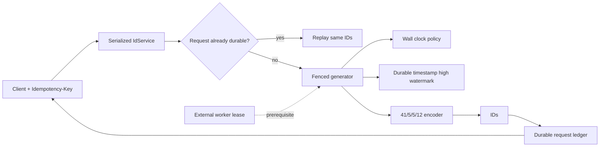

# Architecture

## Boundary

The repository implements one ID worker plus a local durable state machine and HTTP facade. Cross-host assignment of `(datacenterId, workerId)` is deliberately outside the process. Without an exclusive external lease, global uniqueness does not hold.



The dotted edge is not implemented.

## ID identity

An ID is the bitwise composition of:

```text
(timestampDelta << 22) | (datacenterId << 17) | (workerId << 12) | sequence
```

The custom epoch is `2026-01-01T00:00:00.000Z`. All fields are validated before `BigInt` encoding. The maximum combination equals `2^63 - 1`, so the sign bit remains clear.

## Durable identity binding

The first state-WAL record binds:

- layout version;
- custom epoch;
- datacenter ID;
- worker ID.

Every later lease and request record requires that identity. Startup with a different binary layout or worker configuration refuses and releases its newly acquired local lock. This prevents accidental state-directory reuse; it does not discover another host using the same identity in a different directory.

## Timestamp lease algorithm

State stores a durable `highWatermark`, meaning “the prior process may have emitted any timestamp up to this millisecond.” Before the generator enters an uncovered timestamp, it appends and syncs a new horizon:

```text
new high watermark = min(target + leaseDuration - 1, wallClock + maxFutureDrift)
```

Only after that sync can it emit from the range. After restart, the first target is `max(wallClock, previousHighWatermark + 1)`. This turns uncertain prior sequence use into an intentional time gap.

The default 100 ms horizon amortizes state I/O. Longer leases reduce fence writes but increase the restart jump and reserved gap. Repeated restarts stop when the next safe timestamp would exceed the 5,000 ms default future-drift budget.

## In-process sequence

- At a new logical millisecond, sequence starts at 0.
- Same-millisecond calls increment through 4,095.
- The next call advances logical time by one millisecond instead of wrapping to a duplicate.
- All generate/batch operations share one promise queue, so concurrent callers observe one stream.
- Wall-clock regression beyond `maxClockRollbackMs` fails closed. Within an explicitly nonzero tolerance, logical time stays monotonic and can lead wall time.

## Request ledger

`IdService` serializes allocation requests. It checks the durable ledger, generates a batch only when absent, appends and syncs `{requestId,count,ids}`, and only then returns. Duplicate concurrent requests therefore converge on one allocation.

If request-ledger sync fails after ID generation, those IDs are burned inside an already durable timestamp lease. They were not acknowledged by HTTP and are never reused. Gap-free allocation is not a goal.

## Lock and recovery

Opening state atomically creates `generator.lock` with mode `0600`, a random token, PID, and acquisition time. Graceful close verifies its token before unlinking. A crash leaves it, preventing automatic double start.

Recovery requires:

1. an external decision that the prior process is dead;
2. the exact token read from the protected lock file;
3. an explicit recovery command.

The command verifies the token and removes the file without printing the token. The boolean death confirmation is an operator assertion, not a failure detector; deleting a live process's lock can create duplicates.

## Invariants

1. Every returned ID fits in signed-positive 63 bits and decodes under the declared layout.
2. One live generator's output is unique and strictly numerically increasing.
3. Sequence never wraps inside the same logical millisecond.
4. A timestamp is issued only inside a previously synced durable horizon.
5. Restart never issues at or below the previous horizon.
6. The state directory never accepts another layout/datacenter/worker identity.
7. One local state directory has at most one lock owner under the atomic-create assumption.
8. HTTP success follows a synced request-to-ID mapping; equal retry returns equal IDs.
9. Clock/future-drift violations reject generation rather than reuse a pair.

Global uniqueness additionally requires an external invariant: no two live state directories anywhere share the same datacenter/worker pair. The negative test demonstrates the collision when it is violated.

## Failure windows

| Window | Observable result | Response |
|---|---|---|
| Crash after horizon sync, before any ID | Reserved gap | Restart after reviewed lock recovery; never reclaim gap |
| Crash after ID generation, before request sync | Burned unacknowledged IDs | Retry same request; a new safe allocation is allowed |
| Crash after request sync, before HTTP response | Client uncertainty | Retry same key/count; ledger replays exact IDs |
| Wall clock moves backward | `503` beyond tolerance | Fix clock; keep same request identity |
| Repeated restart outruns wall | Future-drift `503` | Wait for wall time or investigate clock; do not raise silently |
| Duplicate worker identity on another host | Possible exact collision | Stop both; repair external lease assignment |
| Wrong token used for recovery | Recovery fails | Re-read protected receipt; do not delete manually |
| WAL truncation/checksum failure | Startup fails | Preserve and restore/repair state; do not skip frame |

## Durability boundary

State frames and the lock file are individually synced and checksum-verified. The parent directory is not separately synced, and the checksum is not an authenticated MAC. The runtime smoke proves process `SIGKILL` recovery on the CI filesystem; it does not prove sudden power loss, storage-controller behavior, malicious tampering, or cross-host fencing.
